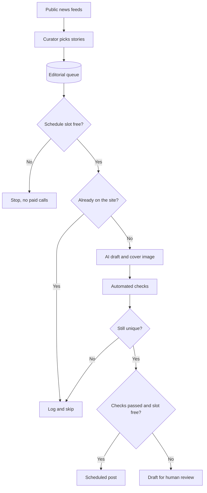

# Pixel Magazine — editorial automation pipeline

A case study of the n8n pipeline behind [pixelmagazine.pt](https://pixelmagazine.pt), an independent Portuguese tech publication I built and run on my own.

The pipeline uses AI to select stories from public news feeds, draft Portuguese articles with cover images, check the result and schedule it for publication. Articles link to their original source. Anything that fails a check, or can't be verified, stays as a draft for human review.

> This is a write-up, not the source. The workflows, prompts and editorial rules are private.

## The problem

Running a daily publication alone needs automation, but a simple "RSS → LLM → publish" chain breaks in expensive ways: it pays for work that can't be scheduled, publishes the same story twice, and treats a bad model response as a finished article.

I wanted a system that keeps a steady schedule, spends money only when there is real work to do, and does the safe thing when something goes wrong.

## How it works



## Key decisions

**Check capacity before spending.** The schedule and duplicate checks run before any paid API call. When the schedule is full, the run stops at no cost and the story stays in the queue.

**Fail towards a draft.** A missing verdict, an unreadable response or a lost schedule slot never publishes anything. The article is saved as a draft instead.

**Verify in two layers.** Free deterministic checks cover structure, formatting and image sanity. An AI reviewer with vision then looks at the article and its cover, but can only reject it using a closed list of failure codes. The first version had no such limit: it invented its own rules and sent almost everything back to draft.

**Guard against duplicates twice.** An article is only created a few minutes after the first duplicate check, so two overlapping runs could both pass it. This happened in production, so a second check now runs immediately before the post is created.

## Example: rolling schedule

Each post follows the last one scheduled, rather than a fixed grid, so a post scheduled by hand simply shifts the rest of the day. Simplified:

```js
function nextSlot(lastScheduled, now) {
  let next = lastScheduled ? lastScheduled + GAP : now + MARGIN;
  next = Math.max(next, now + MARGIN);

  if (timeOfDay(next) < OPENS) next = startOfDay(next) + OPENS;
  if (timeOfDay(next) > CLOSES) next = startOfNextDay(next) + OPENS;

  // No slot means the run stops here, before any paid call.
  return daysAhead(next, now) > MAX_DAYS_AHEAD ? null : next;
}
```

## In numbers

As of November 2026:

- **2 production workflows** with 56 nodes
- **About 3,000 lines** of JavaScript in custom code nodes
- **About 470 runs in 14 days** of the main workflow, 94% of them successful
- **2,000+ articles** in the site's archive

## Stack

n8n · JavaScript · WordPress REST API · OpenAI API · Google Sheets

## Related

[pixel-magazine-theme](https://github.com/FranciscoPedroso/pixel-magazine-theme) — the custom WordPress theme for the publication.

---

Francisco Pedroso · [franciscopedroso.com](https://franciscopedroso.com)
